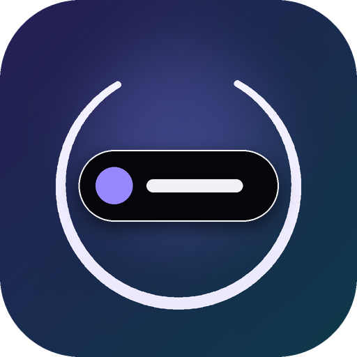

<h1 align="center">Zen Island</h1>

Остров сверху экрана для Windows: музыка, уведомления, запись экрана, FPS в играх и живой питомец.

## Установка
1. Открой **Releases** справа на странице и скачай `ZenIsland-Setup.exe` из последней версии.
2. Запусти. Если Windows покажет «Система Windows защитила ваш компьютер» — нажми «Подробнее» → «Выполнить в любом случае» (программа не подписана платным сертификатом, это нормально).
3. Выбери папку и нажми «Установить». Остров появится сверху экрана — кликни по нему.

Обновления остров находит сам и ставит по одному клику. Удалить — через «Параметры → Приложения → Установленные приложения».

## Сборка из исходников
Нужен MinGW-w64 (MSYS2 или w64devkit): `build.bat` на Windows или `./build.sh` на Linux. Получится `build/ZenIsland.exe` и установщик `build/ZenIsland-Setup.exe`. Версия — в `src/version.h`.

## Что умеет
- **Покой:** показывает время. Если что-то играет, то обложку, время и эквалайзер.
- **Смена трека:** остров на ~3 секунды раскрывается и показывает название и исполнителя.
- **Клик:** открывается большой плеер с обложкой, названием, прогресс-баром и кнопками ⏮ ⏯ ⏭. Если увести мышь, он сворачивается.
- **Колёсико над островом:** меняет системную громкость.
- **Под музыку:** низ острова волнится, а цвет подсветки берётся из обложки.
- Работает с любым плеером из системного медиа-оверлея Windows: Spotify, Яндекс Музыка, SoundCloud и музыка в браузере, AIMP и т.д. Ролики YouTube не показываются.
- В полноэкранных играх и видео остров прячется.
- В трее: «Настройки…», «Анимация под музыку» (выключи, чтобы было ещё экономнее) и «Запускать вместе с Windows».

## Что нового в 1.8 — готово к релизу

- **Новая иконка и логотип.**
- **Установщик** `ZenIsland-Setup.exe`: папка на выбор (если есть диск D — по умолчанию туда), ярлыки, автозапуск, запись в «Установленные приложения», удаление с вопросом «удалить ли историю и настройки». Данные старой версии переезжают сами.
- **Автообновление**: остров раз в несколько часов смотрит последний релиз на GitHub и предлагает «Обновить» — скачивает установщик и тихо ставит новую версию поверх.
- **Надёжность**: журнал ошибок `data/zenisland.log` (кнопка в «О программе»), при падении — дамп и автоматический перезапуск, восстановление после сна и смены мониторов.
- **Скорость**: в простое остров почти ничего не рисует; движения питомца реже, неиспользуемая память возвращается Windows.
- **FPS сразу после включения ПК**: в «Игры» можно включить запуск с правами администратора через Планировщик заданий.
- **Знакомство** при первом запуске (5 подсказок) и **бэкап**: сохранить/загрузить все настройки одним файлом.

## Что нового в 1.7 — Zen Island (предрелиз)

**Новое имя** — Zen Island. Программа теперь `ZenIsland.exe`; настройки, история буфера и автозапуск перенеслись сами. Старый `DynamicIsland.exe` можно удалить.

**Настройки стали понятнее**
- Разделы: Главное · Вид · Питомец · Музыка · Уведомления · Игры · Инструменты · Календарь · Дополнительно · О программе.
- «Главное» — только то, что реально нужно: открытие при наведении (по умолчанию выключено — открывается кликом), автозапуск, «не беспокоить», размер, что показывать рядом с часами, город для погоды.
- Всё для любителей покрутить (отступ, клики сквозь остров, вкладки, эффекты) — в «Дополнительно».

**Вид**
- Оставлены 8 стилей: Чёлка, MacBook, iPhone, iOS 26 · стекло, Аврора, Windows 11, Material You, Сезонный.
- «Свой стиль» открывает конструктор: сверху большое живое превью, под ним форма, фон, рамка, скругление, прозрачность, шрифт, тень, частицы. Меняешь — превью и сам остров обновляются сразу.

**Питомец** — отдельный раздел с галереей: видно, как выглядит каждый (наведи — попрыгает).
- Новые: Лягушонок, Пингвин, Лисёнок. По умолчанию — Капля.
- Живее: иногда сам подпрыгивает, покачивается, оглядывается, сплющивается. Реакции и сон можно выключить.

**Убрано пока**: заметка, таймер и напоминания.

**Исправлено**: уведомления Windows — значок приложения больше не вылезает за рамку, а заголовок не налезает на «Приложение · сейчас»; длинный текст обрезается с «…».

## Что нового в 1.6

**Игровой режим стал умнее**
- Окно на весь экран ещё не значит игра: остров 2–7 секунд смотрит, грузит ли программа видеокарту (или выдаёт кадры), и только тогда включает пилюлю с FPS. Фото в Telegram, видео и прочее больше не включают игровой режим.
- Итоги после игры: закрыл игру — остров покажет, сколько играл и средний FPS (если сессия дольше 2 минут). Работает и для игр в эксклюзивном полноэкранном режиме, где Windows не пускает никакие окна поверх.

**Запись экрана**
- Режимы по порядку: «Окно · Область · Весь экран».
- Выбор устройств: микрофон и выход (наушники/колонки), чей звук записывать. Нажми на название устройства рядом с «Микрофон» / «Звук компьютера».

## 1.5.1 — исправления

- Игровой режим включается и в «оконном без рамки на весь экран»: окно сравнивается с его собственным монитором (с учётом масштаба Windows), а игры с античитом, которые прячут свой процесс, тоже считаются играми. Список «видео и браузеров» теперь по точным именам — раньше кусок имени вроде «opera» мог выключить игровой режим. В Настройки → Остров → Игры видно, какую программу остров заметил на весь экран и что решил.
- Плеер больше не показывает обложку, если музыку в браузере открыли, но не включали. Таймер «прятать на паузе» считается от момента, когда музыка последний раз играла.

## Что нового в 1.5

**Музыка из браузера снова видна**
- Яндекс Музыка, Spotify, SoundCloud и YouTube Music в браузере показываются, а ролики YouTube — нет. Теперь остров отличает их по обложке: у трека она квадратная, у ролика — кадр 16:9 (у Shorts — 9:16).

**Игры**
- Пилюля с FPS чаще поднимается поверх игры на весь экран.
- Во время записи в полноэкранной игре остров прячется совсем.

**Запись экрана**
- Режимы «Окно / Весь экран / Область». «Окно» — список открытых окон с иконками; выбранное окно выходит вперёд, и запись едет за ним, если его подвинуть. По горячей клавише в режиме «Окно» пишется активное окно.
- Микшер: громкость звука компьютера и микрофона (0–200 %), живые индикаторы уровня (зелёный → жёлтый → красный). Громкость можно менять прямо во время записи.

## Что нового в 1.4 — запись экрана как в OBS (на минималках)

**Вкладка «Запись»** (вместо «Полки» — полку убрали)
- Большая кнопка старта, выбор «Область» или «Весь экран», отсчёт 3-2-1.
- Звук компьютера и микрофон — в одну дорожку AAC, микрофон можно глушить прямо во время записи.
- Пауза и продолжение, курсор вкл/выкл, 30 или 60 кадров, качество «Эконом / Обычное / Высокое».
- Своё сочетание клавиш: нажми на кнопку и зажми нужные клавиши (Esc — отмена).
- Своя папка (по умолчанию «Видео\Dynamic Island») и три последние записи с миниатюрами: клик — открыть, папка — показать в проводнике.

**Исправления**
- Ролики YouTube из Zen, Firefox и их форков больше не показываются как музыка.
- Остров открывается по клику, а не при наведении (наведение можно вернуть в настройках «Остров»).
- Загрузки видны и из Zen/Firefox: остров смотрит папку, которую выбрал браузер, рабочий стол и временную папку, а не только «Загрузки».
- «Управление»: на компьютере без Wi-Fi плитка показывает «Интернет · По кабелю», VPN — страну вместо длинного IPv6, «Не беспокоить» влезает целиком, исправлен значок темы, графики CPU/GPU тянутся на всю карточку.

## Что нового в 1.3 — игры, док и характер

**Игровой режим**
- Запустил игру на весь экран — остров не исчезает, а сжимается в маленькую пилюлю «143 FPS · CPU 39% · GPU 91%». FPS подсвечивается зелёным, жёлтым или красным.
- Клики в игре проходят сквозь остров — он никогда не перехватит мышь.
- FPS считается через счётчики DirectX (как в PresentMon/Afterburner, ловит и OpenGL/Vulkan — например, Minecraft). Для этого нужны права администратора: Настройки → Остров → Игры → «Перезапустить». Без прав пилюля показывает CPU · GPU · RAM.
- Браузеры, видеоплееры и презентации игрой не считаются. Если хочется по-старому — «Игра на весь экран: прятать остров».

**Док программ с поиском**
- «+» на «Главной» открывает поиск: пишешь название — сразу видно программы из меню «Пуск» (и магазинные тоже) с иконками. Клик или Enter — добавить, ещё клик — убрать. Колесо листает. «Обзор…» — если нужен конкретный файл.

**Пункт управления**
- Новая строка «Микрофон · Камера»: кто прямо сейчас слушает микрофон или смотрит в камеру.

**Персонаж с характером**
- Радуется, когда включаешь музыку или возвращаешься к компьютеру, и влюбляется, если подержать на нём курсор.
- Обижается, когда ставишь музыку на паузу, и злится, если быстро листать треки.
- Ночью (с 23:00) зевает и засыпает быстрее.

## Что нового в 1.2 — в духе islandapp

**Видео больше не считается музыкой**
- Ролики YouTube (и другие видео в браузере) фильтруются: плеер на острове не появляется. YouTube Music, Яндекс Музыка, Spotify и т.п. работают как раньше.
- Настройки → Музыка: «Только музыка из браузера», список источников (можно отключить любое приложение), «Скрывать плеер на паузе» — сразу / через 1 / 5 / 15 минут / никогда.

**Исправления**
- Поля ввода (город, календарь, напоминание, быстрый ответ, исключения) теперь рисуются самим островом: текст, курсор и выделение видны, работают Ctrl+A/C/X/V, стрелки, Home/End.
- Прокрутка настроек плавная, ползунок можно тянуть мышью; колесо вне «Главной» больше не меняет громкость.

**Новое**
- Персонажи: 5 своих зверушек живут на острове вместо иконки — моргают, следят за курсором, танцуют под музыку и засыпают, если вы отошли (Вид → Персонаж).
- VPN: плитка на вкладке «Управление» и тост при включении/выключении VPN со страной и IP.
- Предупреждение о дожде за 1–2 часа (Уведомления).
- Список исключений: остров прячется в выбранных программах (Остров → Исключения).
- Режим «сквозь клики»: свёрнутый остров не мешает нажимать то, что под ним.
- Размер острова до 200%.

## 1.1.1 — исправления
- Настройки прокручиваются колесом в любом месте правой части, в том числе над карточками стилей и переключателями (раньше «Вид» не листался).
- Поля ввода (город, ICS-ссылка, заметка, текст, напоминания) надёжно берут фокус по клику и не прячутся под остров.

## Что нового в 1.1 — ещё стили и «фишки»
- **Новые стили:**
  - **Минимал** — в покое тонкая полоска, которая светится цветом происходящего. При наведении становится обычным островом.
  - **Windows 11** — Mica, скругления и шрифт как в Windows.
  - **Material You** — цвета берутся из твоих обоев и меняются вместе с ними.
  - **Пиксель** — углы лесенкой и пиксельная рамка.
  - **Терминал** — зелёная консоль.
  - **Сезонный** — сейчас осень, поэтому падают листья. Зимой будет снег, весной лепестки, летом светлячки. С 15 декабря по 10 января по краю горит гирлянда.
- **Свой стиль (конструктор):** форма, фон, рамка, скругление, толщина рамки, тень и сезонные частицы. Стиль можно сохранить в файл `.island-style` и загрузить чужой.
- **Шрифт:** Segoe UI, Segoe UI Variable, Bahnschrift или Consolas.
- **Фишки** (Настройки → Фишки, каждую можно выключить):
  - **прогресс по контуру** — таймер бежит светящейся полоской по краю, загрузки бегают огоньком;
  - **раздвоение** — если идут две активности сразу (например, таймер и музыка), рядом отделяется «пузырь» с обложкой, кольцом таймера или загрузкой, с ртутной перемычкой. Клик по пузырю открывает нужное;
  - **перекатывающиеся цифры** — часы и таймер меняются, как в iOS;
  - **потянуть вниз** — схвати остров и тяни, он резиново растягивается и раскрывается;
  - **тряска «нет»** — при ошибке остров коротко трясётся;
  - **частицы** — конфетти по таймеру и помодоро, искры при отправке скриншота или ответа, салют (команда `салют` в Alt+Space);
  - **мягкая тень** под «парящими» стилями;
  - **звуки интерфейса** — тихие, генерируются на лету, без файлов;
  - **обложка «дышит»** в такт басу и светится цветом трека;
  - **Новый год** — с 20 декабря в покое видно, сколько дней осталось, 31-го с 23:00 идёт обратный отсчёт до полуночи, в полночь салют.
- **Плавная смена стилей:** остров переезжает с края в капсулу и обратно, ушки втягиваются, без мигания.

## Что нового в 1.0 — стили и «живые» анимации
- **Готовые стили** (Настройки → Вид → «Стиль острова»), выбираются карточками с превью:
  - **Чёлка** — как было: прирос к краю, вогнутые «ушки», волна снизу.
  - **MacBook** — строгая чёрная чёлка с маленькими ушками и аккуратными углами, всегда чёрная.
  - **iPhone** — капсула, которая висит под краем экрана.
  - **iOS 26 · стекло** (Liquid Glass) — настоящее стекло: под островом размытый и чуть более насыщенный кусок экрана, а блик по краю поворачивается за мышью. Остров при этом исключается из захвата экрана, поэтому не попадает на скриншоты и записи. Нужна Windows 10 2004 или новее, иначе стекло матовое.
  - **Неон** — светящийся переливающийся край в цвет обложки.
  - **Аврора** — живой градиент внутри острова, переливается в такт музыке.
- **Анимации:** «Спокойные», «Живые» или «Пружинистые».
  - Содержимое появляется с подрастанием, а не просто проявляется.
  - Вкладки въезжают с той стороны, куда переключил.
  - Остров слегка проминается при клике.
  - В «Пружинистых» смена размеров идёт с отскоком.
- Неон и аврора двигаются, только когда остров и так анимируется (музыка, раскрытие). В покое картинка стоит и ничего не тратит. Стекло обновляет подложку примерно 2 раза в секунду.

## Что нового в 0.9
- **Разметка скриншотов.** После снимка области (Ctrl+Alt+S) открывается редактор.
  - Инструменты: стрелка (A), рамка (R), маркер (M), карандаш (P), текст (T), номера-шаги (N), размытие для личных данных (B), обрезка (C).
  - Цвета 1–6 и три толщины. Shift делает линии ровными. Отмена — Ctrl+Z, повтор — Ctrl+Y.
  - Кнопки: «Готово» (Enter) кладёт снимок в буфер, на полку и в папку `screenshots`. «Копировать» (Ctrl+C), «Сохранить как…» (Ctrl+S), «Перетащить» — тащи прямо в Telegram.
  - Тост «В буфере · тащи в чат» после «Готово» тоже можно утащить мышью в любое окно.
  - Редактор отключается в настройках: Инструменты → «Редактор после снимка области».
- **Заряд AirPods и Beats.** Когда наушники подключаются, остров ловит их Bluetooth-рекламу, как iPhone, и показывает карточку: левый, правый и кейс, с отметкой зарядки. Вручную — команда `наушники` (кейс открыт рядом). Galaxy Buds и другие показывают заряд, если его отдаёт Windows.
- **Система.** Во вкладке «Управление» появились карточки «Процессор», «Видеокарта», «Память», «Сеть» с графиками за минуту. В покое можно показывать по бокам от часов скорость сети или CPU/GPU (Настройки → Остров). Замер идёт раз в секунду и только пока это видно на экране.
- **Быстрый ответ на уведомления.** У Telegram, AyuGram и других приложений с полем ответа в уведомлении на карточке есть кнопки «Ответить» и «Прочитано». Ответ уходит так же, как из штатного уведомления Windows: через активатор самого приложения.

## Что нового в 0.8
- **Настройки прямо в острове.** Шестерёнка в панели открывает разделы: Остров, Вид, Вкладки, Музыка, Уведомления, Инструменты, Погода и календарь, О программе. Всё применяется сразу. «Настройки…» в трее открывает их же. Старое окно осталось только для `--settings-window`.
- **Командная строка — Alt+Space** (если сочетание занято другой программой, то Ctrl+Alt+Space). Ещё её открывает лупа в панели.
  - программы из меню «Пуск», включая магазинные, а также файлы и папки с рабочего стола, из «Загрузок», «Документов», «Изображений», «Видео» и «Музыки»;
  - Enter открывает, Ctrl+Enter показывает в папке, путь вида `D:\…` можно листать, Tab дополняет;
  - калькулятор: `2^10`, `15% от 3400`, `3400+15%`, `sqrt(2)`, `5!`;
  - единицы: `5 км в мили`, `30 c в f`, `2 гб в мб`, `3 сотки в м2`;
  - валюты по курсам open.er-api.com (кэш на 6 часов): `100 usd в rub`, `$20`, `1000 руб в евро`;
  - команды: `таймер 10`, `напомни завтра в 9 …`, `скриншот`, `текст с экрана`, `тёмная тема`, `громкость 30`, `не беспокоить`, `заметка`, `погода`, `блокировка`, `корзина`…;
  - история буфера и поиск в Яндексе или Google;
  - если набрал не в той раскладке (`ntktuhfv`), всё равно найдёт.
- **Светлая тема:** тёмная, светлая или как в Windows.
- **Акцент:** из обложки, системный или свой из 8 цветов. Регулируется непрозрачность фона.
- **Вкладки:** можно поменять порядок и спрятать лишние.
- **Автоскрытие:** остров уезжает за край экрана и выезжает, когда мышь у верхнего края. Есть опция «не прятать, когда играет музыка».
- **Не беспокоить:** плитка в «Управлении», команда и настройка. Отключает уведомления, системные события и показ трека, а во время звонков может включаться само. В покое рядом со временем видна луна.
- **Монитор «где мышь»:** остров переезжает на монитор с курсором.
- В быстрых действиях названия больше не обрезаются.

## Что нового в 0.7 — новый дизайн
- **Форма «чёлки»:** остров прирастает к верхнему краю экрана, по бокам вогнутые «ушки». Нижний край «жидкий»: когда подводишь курсор снизу, он тянется к мыши. Отступ сверху больше 0 в настройках возвращает старую пилюлю.
- **Раскрытие при наведении** (~0,3 с), клик тоже работает. Панель не сворачивается, пока ты печатаешь в заметке или тексте. Кнопка 📌 закрепляет панель.
- **Покой:** слева значок погоды, по центру время, справа температура.
- **Панель с вкладками** (780×452):
  - **Главная:** плеер с цветом обложки, громкость ползунком и выбор устройства вывода (наушники/колонки), 8 быстрых действий (область, весь экран, текст с экрана, QR, пипетка, «чистый текст» в буфере, запись экрана, буфер), лаунчер своих программ: «+» добавляет, правый клик убирает.
  - **Буфер:** история буфера прямо во вкладке, с поиском с клавиатуры.
  - **Полка:** файлы плитками, «Перетащить все» одним движением, крестик на каждой плитке.
  - **Текст:** редактор и 16 инструментов: неправильная раскладка (ghbdtn → привет), регистры, транслит, склейка строк, лишние пробелы, JSON красиво/в строку, Base64, URL, сортировка и уникальные строки. Если редактор пустой, берётся текст из буфера.
  - **Заметка:** заметка с жирным, курсивом, зачёркиванием, маркером и списком, сохраняется сама (`data\note.rtf`). Рядом таймер (5/10/25 мин, помодоро, +1 мин) и **напоминания обычной фразой**: «позвонить маме завтра в 9», «через 20 минут плита», «таблетки каждый день в 23:00». Ввод через Enter, напоминания хранятся в `data\reminders.txt`.
  - **Погода:** карточка «сейчас» на фоне неба, ветер, влажность, осадки, восход и закат, прогноз по часам и на 7 дней с полосками температуры.
  - **Управление:** Wi-Fi, Bluetooth, тёмная тема, батарея. Блокировка, сон, перезагрузка и выключение (последние три нажимаются дважды, чтобы не промахнуться).
- Новая настройка: «Раскрывать остров при наведении мыши».

## Что нового в 0.6
### Виджеты (в развёрнутом острове, три карточки)
- **Погода** — Open-Meteo, бесплатно и без ключа. Город задаётся в настройках, если пусто — определяется по IP (с VPN покажет город сервера, лучше вписать свой). В свёрнутом виде рядом со временем видно иконку и температуру. Обновляется раз в 20 минут, клик по карточке обновляет сразу.
- **Таймер и помодоро** — кнопки «5 мин», «15 мин», «🍅 25». Пока идёт, остров показывает кольцо прогресса и время. Помодоро чередует 25 мин фокуса и 5 мин перерыва, каждый 4-й перерыв 15 мин. Есть пауза и стоп, по окончании звук и уведомление.
- **Календарь** — ближайшее событие («Сегодня 15:00 · Созвон»). Подключается ICS-ссылкой: Google Календарь → Настройки календаря → «Секретный адрес в формате iCal»; Яндекс → Настройки → Экспорт. Понимает повторы (ежедневно/еженедельно по дням/ежемесячно/ежегодно), исключения и перенесённые встречи. За 10 минут и в момент начала напоминает, ссылку на Zoom/Meet можно открыть кликом.

### Уведомления Windows — без MSIX
Windows хранит все уведомления в обычной SQLite-базе (`%LOCALAPPDATA%\Microsoft\Windows\Notifications\wpndatabase.db`). Остров читает её только на чтение, поэтому упаковка и подпись не нужны.
- Уведомления Telegram, Discord, браузеров и т.д. показываются пилюлей с аватаром отправителя (если приложение его передаёт), заголовком и текстом. Клик открывает приложение. Если навести мышь, уведомление не исчезнет. Несколько уведомлений идут по очереди.
- «Скрывать текст уведомлений» — показывать только отправителя.
- Чтобы не было дублей, выключи у приложений баннеры Windows (Параметры → Система → Уведомления → приложение → «Показывать баннеры»). В базу уведомления попадают и без баннеров.

### Звонки
- Когда Discord, Telegram, Zoom, Teams, WhatsApp, Viber или Skype берут микрофон, остров превращается в пилюлю звонка: приложение, длительность и **кнопка микрофона**. Она выключает микрофон для всей системы, при выключении кнопка красная. Клик по пилюле открывает окно приложения.
- Уведомления со словами «Входящий звонок» показываются с зелёной трубкой и висят дольше.

## Что нового в 0.5
### Инструменты экрана
В развёрнутом острове (клик по нему) есть строка: **Область · Экран · Текст · QR-код · Пипетка · Запись**. Горячие клавиши:

| Сочетание | Что делает |
|---|---|
| Ctrl+Alt+S | скриншот области (клик без выделения — весь монитор) |
| Ctrl+Alt+T | текст с экрана (OCR) |
| Ctrl+Alt+C | пипетка: цвет под курсором |
| Ctrl+Alt+R | начать/остановить запись экрана |

- **Скриншот** сразу копируется в буфер и сохраняется в `screenshots\` рядом с exe. Клик по уведомлению открывает файл.
- **OCR** использует встроенный в Windows движок, офлайн, русский + английский (нужны соответствующие языки в «Язык и регион»). Текст сразу в буфере.
- **QR** ищет код в выделенной области или на всём экране, понимает UTF-8 и светлые коды на тёмном фоне. Если это ссылка, клик по уведомлению её открывает.
- **Пипетка** показывает лупу с сеткой пикселей, по клику HEX уходит в буфер, рядом виден rgb().
- **Запись экрана** — MP4 (H.264, кодек видеокарты), 30 к/с, с курсором, без звука. Пока идёт запись, остров показывает красную точку и таймер, клик по нему останавливает. Сам остров в видео не попадает. Файлы лежат в `recordings\`.

### Полка и загрузки
- **Полка.** Перетащи файл на остров, и он запомнится (сам файл никуда не копируется и не перемещается). Файлы видны в развёрнутом острове. Оттуда их можно утащить в проводник, Telegram, браузер; клик открывает файл, × убирает с полки.
- **Загрузки.** Пока браузер качает (Chrome, Edge, Яндекс, Opera — `.crdownload`, Firefox — `.part`), остров показывает имя файла, сколько скачано и скорость. Когда готово, появляется «Загружено · файл» с кнопкой «Открыть папку». Процента нет, браузеры его не сообщают системе.

## Что нового в 0.4
### Системные события в острове
- **Громкость:** клавиши громкости перехватываются, системный индикатор больше не вылезает, вместо него пилюля с полоской. Шаг 2%. Изменения громкости из других мест (микшер, трей) тоже показываются.
- **Медиаклавиши:** при нажатии ⏯ ⏭ ⏮ остров ненадолго показывает трек.
- **Яркость:** если Windows сообщает об изменении (ноутбуки), показывается пилюля с солнцем и процентом.
- **Наушники:** при смене устройства вывода появляется пилюля с названием («AirPods Pro»). Для Bluetooth — синяя иконка и заряд, если устройство его отдаёт.
- **Батарея (только ноутбуки):** «Зарядка 76%» при подключении зарядки, «От батареи» при отключении, предупреждения на 20% и 10%.
- **Микрофон и камера:** справа от острова горит точка, как на iPhone: зелёная — камера, оранжевая — микрофон. При включении на пару секунд видно, какое приложение их взяло.
- **Caps Lock** и **смена раскладки** (бейдж RU/EN с названием языка).

### Буфер обмена
- **Ctrl+Alt+V** (или трей → «Буфер обмена») открывает панель с историей: тексты, ссылки, картинки с миниатюрами, файлы.
- Сверху поиск: просто начни печатать. ↑/↓ — выбор, Enter или клик — вставить в окно, где ты был. Delete — удалить, Ctrl+P или кнопка-булавка — закрепить. Esc или клик мимо — закрыть.
- Повторно скопированное не дублируется, а поднимается наверх. Закреплённое всегда сверху и не удаляется лимитом.
- Хранится в SQLite: `data\clipboard.db` рядом с exe. Лимит в настройках от 50 до 1000 записей, там же «Очистить историю».
- Менеджеры паролей, которые просят не сохранять (флаг Windows `CanIncludeInClipboardHistory = 0` / `ExcludeClipboardContentFromMonitorProcessing`), пропускаются.

## Что нового в 0.3
- **Текст песни в такт.** Синхронизированный текст подтягивается из LRCLIB. В свёрнутом виде остров показывает текущую строку, слова подсвечиваются по мере пения (караоке). Смена строки анимирована: старая уезжает вверх, новая приезжает снизу. Длинные строки сами прокручиваются за подсветкой. В проигрышах вместо строки пульсирует ♪.
- В большом плеере под кнопками видно текущую строку крупно и следующую серым.
- Тексты кэшируются в `cache\lyrics` рядом с exe. Если текста нет, это тоже запоминается на 3 дня, чтобы не дёргать сервер.
- Если текста нет, остров показывает обычный вид. Названия с YouTube («Артист - Песня (Official Video)») очищаются перед поиском.
- В настройках: «Текст песен в такт» и «Сдвиг текста» (±2 с), если текст спешит или опаздывает.
- **Настоящий визуализатор.** Звук захватывается через WASAPI loopback (то, что сейчас играет в системе), дальше FFT на 16 полос.
  - Волна по низу острова показывает спектр: бас в центре, верха к краям.
  - Эквалайзер: 4 столбика (бас, низкая середина, середина, верха).
  - Детектор ударов: на бочку остров слегка «пульсирует», волна подпрыгивает.
  - Захват работает только пока остров видим и что-то играет. Через 3 секунды после паузы поток останавливается.
  - Если захват недоступен, используется старый режим по пиковому уровню.

## Что нового в 0.2
- **Перемотка:** кликни по прогресс-бару или тащи его. При наведении полоска утолщается и появляется ползунок.
- **Обложка при смене трека** плавно перетекает в новую, цвет подсветки тоже переходит плавно. Заглушка между треками больше не мигает.
- **Источник:** иконка и название приложения (Spotify, Яндекс Музыка, Chrome…) под исполнителем.
- **Бегущая строка:** длинные названия прокручиваются с мягкими краями: пауза, прокрутка, снова пауза.
- **Кнопки:** при нажатии пружинно сжимаются, при наведении плавно подсвечиваются, play/pause морфится одно в другое.
- **Настройки** (трей → «Настройки…» или двойной клик по иконке в трее): монитор, размер острова (80–140%), отступ сверху (0–40 px), анимация под музыку, показ трека при смене, автозапуск. Изменения применяются сразу.
- Запуск с ключом `--settings` сразу открывает настройки.

## Почему лёгкий
- Чистый C++ / Win32 / Direct2D, без .NET, Electron и WebView. RAM порядка 10–20 МБ.
- Кадры рисуются только во время анимации, в покое процессор не тратится. Часы обновляются раз в минуту.
- Отрисовка идёт в маленький буфер размером с пилюлю, клики сквозь прозрачные области работают через попиксельную альфу окна.
- Медиа опрашивается раз в секунду в отдельном потоке с низким приоритетом. Во время полноэкранных приложений раз в 3 секунды, а отрисовки нет совсем.

## Сборка
- Linux / WSL: `./build.sh` (нужен `mingw-w64`)
- Windows: `build.bat` (нужен MinGW-w64 в PATH, например MSYS2 UCRT64 или w64devkit)

## Структура
- `src/island.cpp` — окно, анимации (пружины), отрисовка, ввод, трей
- `src/panel_draw.inc`, `src/panel_logic.inc` — панель с вкладками (рисование и поведение)
- `src/fx.inc` — частицы, звуки, перекатывающиеся цифры, прогресс по контуру, раздвоение, «потянуть вниз», Новый год
- `src/style.inc` — стили острова: стекло, неон, аврора, превью
- `src/editor.cpp` — редактор разметки скриншотов
- `src/pods.cpp` — заряд AirPods из BLE-рекламы
- `src/sysstats.cpp` — CPU/GPU/память/сеть
- `src/extras.inc` — разметка, карточка наушников, графики, быстрый ответ
- `src/settings_panel.inc` — настройки внутри острова
- `src/cmd.inc`, `src/cmdlogic.cpp`, `src/cmdindex.cpp` — командная строка: поиск, калькулятор, единицы, валюты, индекс программ и файлов
- `src/texttools.cpp`, `src/reminders.cpp`, `src/sysctl.cpp` — инструменты текста, разбор напоминаний, Wi-Fi/Bluetooth/тема/звук/питание
- `src/media.cpp` — чтение системной медиа-сессии (WinRT GSMTC через «сырой» ABI) и обложек (WIC)
- `src/island.rc`, `island.manifest`, `island.ico` — ресурсы (иконка, DPI-awareness)
